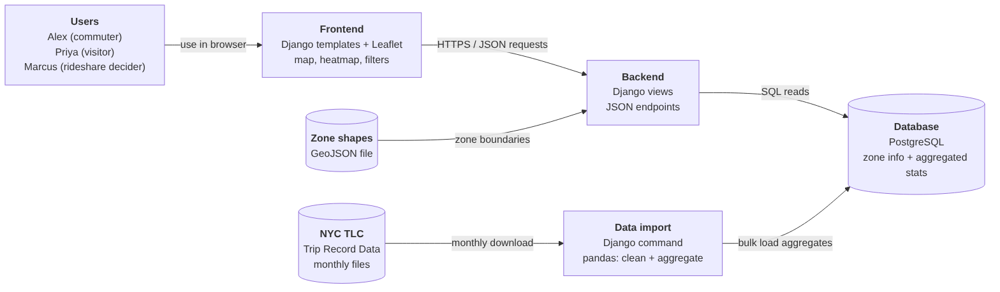
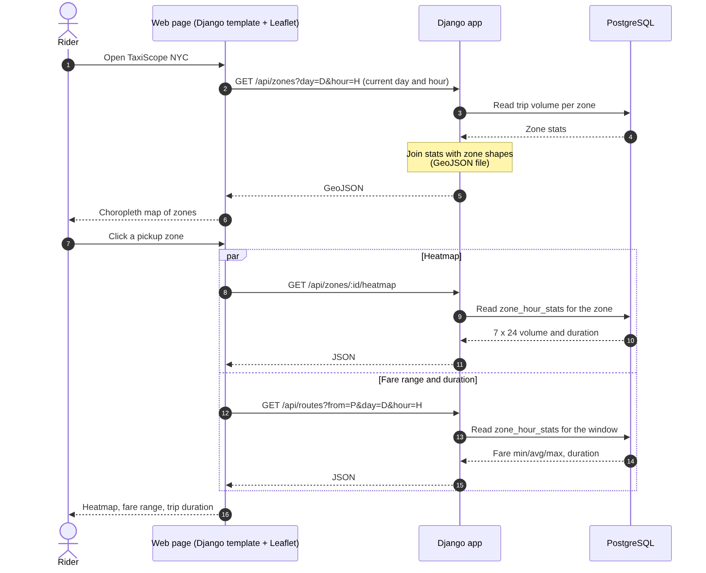
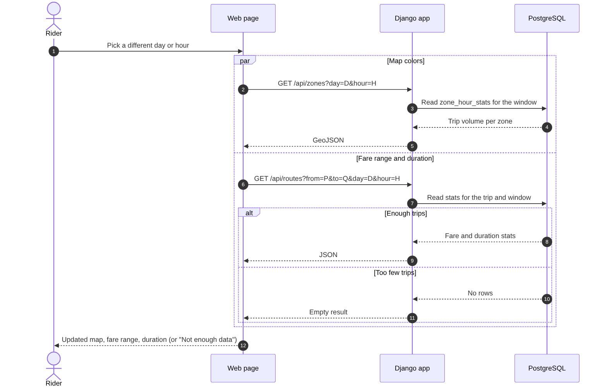
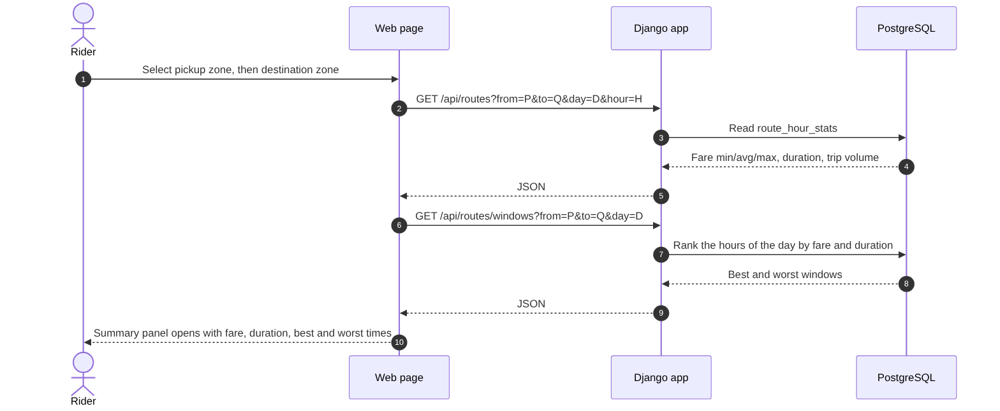
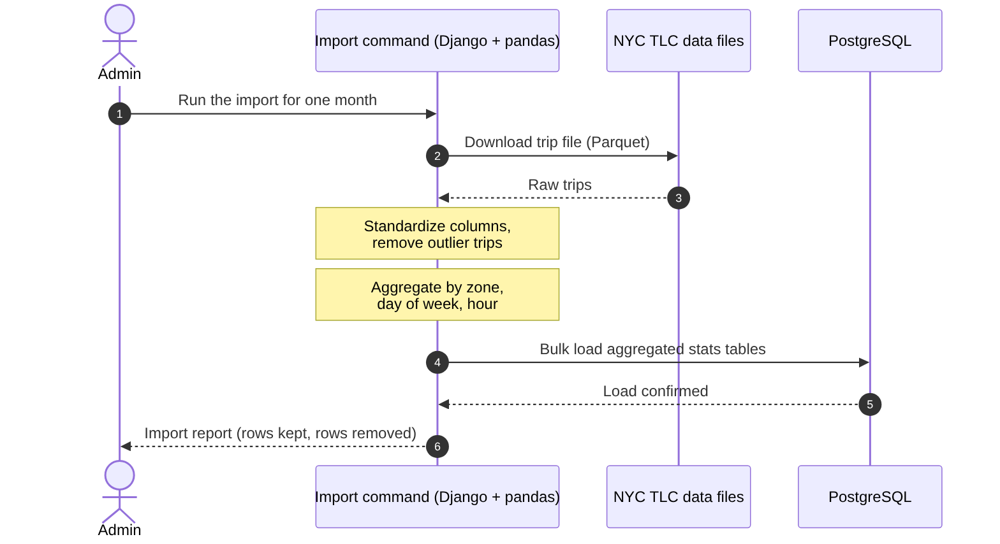
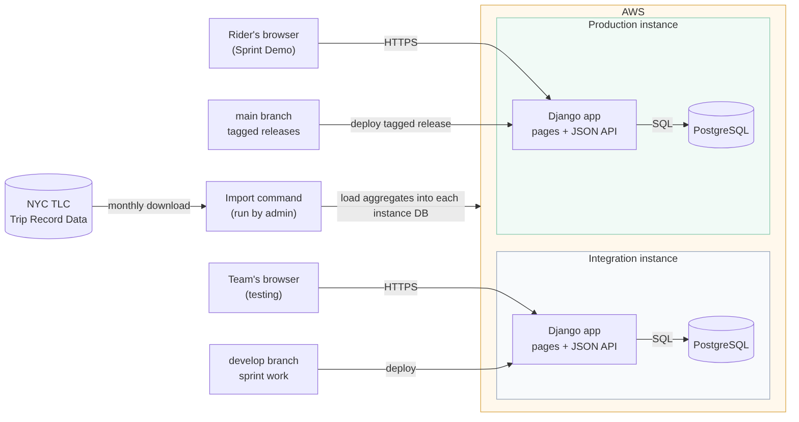

<!-- Copy of the team wiki page. Update the wiki and this file together. -->
# High Level Design: Explore Zone Demand & Fares (Epic 1)

**Project:** TaxiScope NYC | **Team:** Team 5 (Monday) | **Epic covered:** Explore Zone Demand & Fares

This page is the High Level Design for the epic at the center of the system. Everything else in TaxiScope NYC (saved routes, comparisons, ride-sharing, admin tools) reads the data and screens this epic produces. The earlier use-case diagram and epic breakdown are on the **High Level Analysis** page.

## 1. Scope

**In scope (MVP, no account required):**
- Interactive map of NYC taxi zones, colored by demand
- Zone selection with an hour-by-day-of-week heatmap of trip volume and trip duration
- Fare range for the selected zone and time window
- Day and time filters
- Best and worst travel windows
- Trip summary panel for a pickup and destination zone

**Personas served:** Alex (daily commuter), Priya (budget-conscious visitor), Marcus (taxi-vs-rideshare decider)

**Out of scope for this epic:** sign-in, saved routes, "leave by" planning, walk-to-cheaper-zone suggestions, fare reports, comparisons, ride-sharing, moderation.

## 2. Technology choices

The course requires **Python, a Django web application, and AWS hosting**. Within those, we chose the simplest option that fits an epic that only reads precomputed data:

| Area | Choice | Why |
|---|---|---|
| Language and framework | Python + Django | Required by the course |
| Hosting | AWS, two instances: **Integration** and **Production** | Required by the course. Exact AWS services to be decided by the team (see Section 10) |
| Frontend | Django templates + Leaflet (JavaScript map library) | One codebase and one deploy, with no separate frontend app to build and host |
| Database | PostgreSQL | Reliable, valid for the course, and handles the aggregate tables easily |
| Zone shapes | A static GeoJSON file stored in the repo | The map only needs to draw zone boundaries, not run spatial queries, so we do not need PostGIS |
| Data pipeline | A Django management command using pandas and pyarrow | Monthly TLC files fit on one machine once we only keep what we need, so we do not need PySpark |

## 3. Why we used UML (and where we did not)

We used the diagrams that explain how the pieces talk to each other:
- **Sequence diagrams** show how a rider's click moves through the browser, the Django app, and the database. This epic is mostly request and response flows across components, which is what sequence diagrams are for.
- **A deployment diagram** shows where each component runs, including the two AWS instances, because the system includes an offline data import as well as a live web app.
- **Activity diagrams** are used on individual ZenHub stories where a rider flow needs explaining, rather than in this document.

We did not draw detailed class diagrams. The epic is read-heavy: it moves pre-aggregated statistics from a database to a screen, with very few objects that carry behavior. A short data model table (Section 7) shows the same information with less overhead.

## 4. System overview

| Component | Responsibility |
|---|---|
| **Frontend** (Django templates + Leaflet) | Renders the zone map, heatmap, fare range, filters, and trip summary in the browser. Holds the selected zone, day, and time in the page. |
| **Backend** (Django views) | Serves the pages and the JSON endpoints. Joins zone statistics with the zone shapes file, validates query parameters, and does no heavy computation. |
| **Database** (PostgreSQL) | Stores zone information and precomputed zone-by-hour and route-by-hour statistics. |
| **Zone shapes** (GeoJSON file) | Zone boundaries for the map. Loaded by the backend and joined to the statistics by zone id. |
| **Data import** (Django management command, pandas) | Reads one or more monthly TLC trip files, one at a time, cleans them, aggregates by zone, day of week, and hour, and loads the results into the database. |
| **NYC TLC Trip Record Data** (external) | Public source of historical trips and the taxi zone shapes. |

Riders only talk to the Django app through their browser. The app only reads from the database and the shapes file. The import command is the only thing that writes trip statistics, and an admin runs it offline.

## 5. How the pieces connect

Each screen element calls one backend endpoint, and each endpoint reads one table:

| Frontend piece | Backend endpoint | Table read |
|---|---|---|
| Zone map and selected-zone summary | `GET /api/zones?day=&hour=` | `zone`, `zone_hour_stats` (plus the shapes file) |
| Heatmap panel | `GET /api/zones/:id/heatmap` | `zone_hour_stats` |
| Fare range and duration panels | `GET /api/routes` | `route_hour_stats` (pickup and destination), `zone_hour_stats` (pickup only) |
| Day and hour filters | Re-call `/api/zones` and `/api/routes` with the new day and hour | same as above |
| Trip summary and best/worst windows | `/api/routes`, `/api/routes/windows` | `route_hour_stats`, `zone_hour_stats` |

## 6. Key design decision: precompute, don't query raw trips

Raw TLC files hold millions of trips per month. Querying them on every click would make the map lag. Instead, the import command aggregates once per data import, and the API only reads small summary tables. Each aggregate row is keyed by zone, day of week, and hour. The same approach works for pickup-to-destination pairs.

Fare ranges (minimum, average, maximum) are computed after cleaning outliers (zero or negative fares, impossible distances and durations), so a handful of extreme trips does not distort what riders see. Trip duration is derived from pickup and dropoff timestamps. The data does not contain wait time, so the app reports duration only.

## 7. Data model (simplified)

| Table | Key columns |
|---|---|
| `zone` | `zone_id`, `name`, `borough` (the boundary shape lives in the GeoJSON file, keyed by `zone_id`) |
| `zone_hour_stats` | `zone_id`, `day_of_week`, `hour`, `trip_count`, `avg_duration_min`, `fare_min`, `fare_avg`, `fare_max` |
| `route_hour_stats` | `pickup_zone_id`, `dropoff_zone_id`, `day_of_week`, `hour`, `trip_count`, `avg_duration_min`, `fare_min`, `fare_avg`, `fare_max` |

## 8. API surface (Epic 1)

| Endpoint | Returns |
|---|---|
| `GET /api/zones?day=&hour=` | All zones as GeoJSON (name, borough, shape) with trip volume, fare min/average/max, and average duration for the selected day and hour. Defaults to current NYC day and hour. Missing zone-hour stats have a trip count of 0 and null fare/duration values. |
| `GET /api/zones/:id/heatmap` | A 7 x 24 grid of trip volume and average trip duration for the zone |
| `GET /api/routes?from=&to=&day=&hour=` | Fare before tip (minimum, average, maximum), average duration, and trip count for one day and hour. `from` is required; `to` is optional. With only a pickup zone, it covers all trips from that zone (`zone_hour_stats`); with both, that route (`route_hour_stats`). Defaults to current NYC day and hour. Below the minimum trip count (5), `enough_data` is false and the stats are null. Bad or unknown parameters give 400. |
| `GET /api/routes/windows?from=&to=&day=` | The hours of the selected day ranked by average fare and by average duration, with the best (cheapest, fastest) and worst (most expensive, slowest) one-hour windows. `to` is optional, as in `/api/routes`. Only hours with at least the minimum trip count (5) count; fewer than 2 such hours gives `enough_data` false and empty results. Defaults to the current NYC day. |

Every endpoint is public and read-only. When a window has too few trips, the API returns an empty result and the app shows "Not enough data".

## 9. Sequence diagrams

### 9.1 Select a pickup zone and view its heatmap and fare range

The map loads from `/api/zones` for the current day and hour. Django reads the statistics from PostgreSQL and joins them with the zone shapes file. When the rider clicks a zone, the heatmap and the fare range with duration are requested in parallel, so the panels fill in without waiting on each other.

### 9.2 Change the day or hour filter

Changing the day or hour refreshes the map colors and the fare and duration numbers together. The heatmap does not change, because it already covers every day and hour. If a window has too few trips, the rider sees "Not enough data" instead of a misleading number.

Clicking a zone selects it for the fare-range and average-duration summary. Changing either time filter reloads the zone statistics for the selected zone as well as the map; if the selected zone has no trips for that time, the summary shows "Not enough data".

### 9.3 View the trip summary and best/worst windows for a pickup and destination pair

When both zones are selected, the summary panel opens automatically. It combines the fare range and duration for the trip with the best and worst windows for the selected day.

### 9.4 Data import (offline)

An admin runs the import command with the months to load. It cleans and aggregates the raw trips month by month and replaces the statistics in one transaction, so no rider request ever touches raw trip data.

## 10. Deployment diagram

There are two AWS instances, as the course requires:
- **Integration** runs the latest work from the `develop` branch. The team tests here and shows the Product Owner each story's acceptance criteria before it counts as done.
- **Production** runs a tagged release from the `main` branch. The tag matches the ZenHub sprint milestone, and the sprint demo runs only here.

Each instance has its own Django app and its own PostgreSQL database. The import command is run against each database when new monthly data is available.

The exact AWS services (for example, how the Django app and the database are hosted) are still to be decided by the team. The diagram shows the instances and how they connect, which will not change with that choice.

## 11. Risks specific to this epic

| Risk | Mitigation |
|---|---|
| Deploying to AWS late leaves nothing to demo on Production | Set up the Integration and Production instances in the first sprint and deploy a very small slice early |
| Schema changes across months of TLC files | Standardize column names in the import command before aggregating |
| Outlier fares and durations skew results | Cleaning rules in the import command before min/avg/max are calculated |
| Map feels slow | Precomputed aggregates, indexed by zone, day, and hour; zone shapes loaded once from a static file |
| Sparse data in some zones and hours | Set a minimum trip count and show "Not enough data" instead of a misleading number |

## 12. How this design maps to the user stories

| Story | Components involved |
|---|---|
| US0: Import and prepare TLC data (enabler, split into smaller stories) | Import command, `zone`, `zone_hour_stats`, `route_hour_stats` |
| US1: View Taxi Demand Map | Zone map, `/api/zones`, `zone`, `zone_hour_stats`, zone shapes file |
| US2: Select Trip Zones | Zone map and page state (pickup and optional destination); no extra endpoint |
| US3: View Demand Heatmap | Heatmap panel, `/api/zones/:id/heatmap`, `zone_hour_stats` |
| US4: Filter by Time | Day and hour filters, which re-call `/api/zones` and `/api/routes` |
| US5: View Fare Range | Fare panel, `/api/routes`, `route_hour_stats` or `zone_hour_stats` |
| US6: View Trip Duration | Duration panel, `/api/routes` (same response as the fare range) |
| US7: Find Best and Worst Travel Times | `/api/routes/windows`, `route_hour_stats` |
| US8: View Trip Summary | Summary panel combining `/api/routes` and `/api/routes/windows` |
| US9: Use Without an Account | No sign-in anywhere in this epic: every endpoint above is public and read-only |

## 13. Epic 2 extension: Leave By (US15)

The Arrive by form in the trip summary accepts a weekday and a time in 15-minute steps after the rider selects both zones. It calls the public `GET /api/routes/leave-by?from=&to=&day=&arrive=HH:MM` endpoint. The endpoint validates known zone ids, weekday 0-6, and a quarter-hour arrival time, then reads `route_hour_stats`.

The planner first subtracts the arrival hour's average journey duration. It reads the resulting departure hour (including the previous day if necessary), subtracts that hour's average duration once more, and rounds the leave time down to a 15-minute boundary. The departure hour supplies the displayed typical duration and average fare. If the arrival or departure hour has fewer than `MIN_TRIP_COUNT` trips, the response has `enough_data: false` and the page shows Not enough data. The page labels a result as an estimate from March to May 2026 trips, not a guarantee.

## 14. Epic 2 extension: Cheapest in the next 3 hours (US16)

The Leave by panel has two options: **Arrive by** (US15) and **Cheapest in the next 3 hours**. The second takes a weekday and a start time, either from a **Now** button (the current New York day and time, computed in the browser with the `America/New_York` time zone) or from a custom day and a start time in 15-minute steps. It calls the public `GET /api/routes/cheapest?from=&to=&day=&start=HH:MM` endpoint, which validates known zone ids and weekday 0-6 like `/api/routes/leave-by`. `start` may be any `HH:MM` (00:00–23:59), so Now can send the exact current minute.

The window is 3 one-hour slots: the start hour and the next 2 hours from `route_hour_stats`. After midnight it continues into the next day, and Sunday wraps to Monday (Friday 22:00 covers Friday 22:00, Friday 23:00 and Saturday 00:00). Only slots with at least `MIN_TRIP_COUNT` trips are compared. The lowest average fare wins, and on a tie the earlier hour wins. The suggested departure is the start time if the first slot is cheapest, otherwise the start of the cheapest hour. The expected arrival is that departure plus the cheapest hour's average duration, rounded to the minute.

The response lists all 3 slots (`day`, `hour`, `enough_data`, `trip_count`, `fare_avg`, `avg_duration_min`), the index of the cheapest (`cheapest`), and `leave_day`, `leave`, `arrive_day`, `arrive`, `avg_duration_min` and `fare_avg`. If no slot has enough trips, `enough_data` is false and the suggestion fields are null. The page shows Not enough data for each sparse hour, says so when none qualifies, and labels the result an estimate from March to May 2026 trips, not a guarantee.

## 15. Epic 2 extension: Saved "Leave by" plans (US17)

A signed-in rider can save the plan behind either Leave by result ("Arrive by" or "Cheapest in the next 3 hours"). The map shows "Save this plan" under the result; guests see a sign-in link instead. The browser posts the plan to `POST /plans/save/` (CSRF token in the `X-CSRFToken` header) with `name`, `pickup_zone`, `dropoff_zone`, `mode` (`arrive_by` or `cheapest`), `day_of_week` (0-6) and `time` (`HH:MM`). The owner always comes from the session. A plan made with Now is saved with the day and exact time it was made.

The `routes_tripplan` table (`routes.TripPlan`) stores only those inputs: user, name, pickup zone, dropoff zone, mode, day of week and time, plus the creation time. Names are unique per user. The user link uses `on_delete=CASCADE`, so deleting an account deletes its plans (US12).

| Page | What it does |
|---|---|
| `GET /plans/` | My plans: the signed-in user's plans with route, mode, day and time |
| `GET /plans/<id>/` | Opens a plan and **recalculates** its result from `route_hour_stats` with the same code as `/api/routes/leave-by` and `/api/routes/cheapest`. Nothing about the result is stored, so it is never stale |
| `GET/POST /plans/<id>/edit/` | Change the day or time; the plan then shows the updated result |
| `GET/POST /plans/<id>/delete/` | Confirm, then delete |

All plan pages require sign-in, look plans up with `user=request.user` (another user's plan gives 404), and use CSRF tokens on every form.

## 16. Epic 2 extension: Cheaper adjacent pickup (US19)

When the rider has selected a pickup and a different destination, the trip summary lists up to 3 neighbouring pickup zones where the same trip is historically cheaper. It calls the public `GET /api/routes/nearby?from=&to=&day=&hour=` endpoint. `from` and `to` must be known zone ids (`to` is required), and `day` (0-6, Monday=0) and `hour` (0-23) default to the current NYC day and hour as in `/api/routes`; invalid requests return 400. "Neighbouring" means sharing a border, from `zones/data/zone_neighbors.json` (US18), loaded once per process. A zone is suggested when it borders the pickup, is not the destination, and its route to the same destination at the same day and hour in `route_hour_stats` has a lower average fare than the current route; both routes need at least `MIN_TRIP_COUNT` trips, and an equal fare does not count. The endpoint makes two queries: the current route, then all neighbouring routes at once. Suggestions are sorted by biggest saving, then lower zone id.

The response has `from`, `to`, `day`, `hour`, `enough_data` (the current route has enough trips), `current` (`trip_count`, `fare_avg`, `avg_duration_min`), `neighbor_count` (adjacent zones considered, without the destination) and `suggestions`, each with `zone_id`, `name`, `borough`, `trip_count`, `fare_avg`, `avg_duration_min` and `saving` (current average fare minus the suggestion's). The page says "No zones border this pickup zone" when `neighbor_count` is 0 (even if `enough_data` is also false, since an island can never get a suggestion), "Not enough past trips" when `enough_data` is false, and "No adjacent pickup zone is cheaper" when the list is empty. Clicking a suggestion sends `taxiscope:select-route`; `filters.js` makes that zone the pickup, keeps the dropoff, and the summary reloads. Same-zone trips show no suggestions. The section is labelled as based on past trips (March to May 2026), not guaranteed.

## 17. Epic 2 extension: Export a plan to a calendar (US21)

A signed-in rider can download any of their plans as an iCalendar (.ics) file from the plan page (`GET /plans/<id>/calendar.ics`, own plans only, `@login_required`). The plan is recalculated with `plan_result()` at download time, and the event is placed on the next New York date on which its start has not passed: the leave time, or, when there is not enough data, the arrival time ("Arrive by") or the start time ("Cheapest") as a zero-length event. Times are written as New York wall-clock times with `TZID=America/New_York` and a `VTIMEZONE`, so Google Calendar and Apple Calendar show the right local time across daylight-saving changes. The title names the route; the description gives the leave and arrival times, typical journey time, typical fare before tip and the plan name, labelled as based on March to May 2026 trips, not a guarantee. The file holds nothing about the user beyond the plan itself (UID `tripplan-<id>@taxiscope`, no organizer or attendees). An optional "Repeat every week" checkbox adds a weekly rule. `routes/calendar.py` is generic so the US20 multi-stop plans can reuse it.

A day plan (US20) can be exported the same way (US21 part 2): `GET /day-plans/<id>/calendar.ics`, own plans only, writes one event per leg with `routes/calendar.py`. The first leg goes on the next New York date for the plan's day on which its leave time has not passed, and each leg starts at its own leave time; a leave time earlier than or equal to the previous leg's moves that leg and the ones after it to the next day (22:00 then 00:30 is 00:30 the next day); an event ends after the leg's typical duration, or is zero-length when there is not enough data. UIDs are `dayplan-<id>-leg-<n>@taxiscope`, the file holds nothing about the user beyond the plan, and an optional weekly repeat applies to every event. The day plan page's button and the file come from the same `day_plan_calendar()`.

## 18. Epic 2 extension: Multi-stop day plans (US20)

A signed-in rider can plan several trips on one day as a chain of 3 to 10 stops (for example Brooklyn Heights → Midtown Center → Times Sq). The `routes_dayplan` table stores the plan (user, name, day of week) and `routes_dayplanstop` stores its stops in order, each with a leave time except the last. Each pair of consecutive stops is one leg, leaving at the first stop's time. On the map, a Day plan block under the Pickup and Dropoff rows builds the chain. "+ Add stop" first records the selected pickup and dropoff, then arms the map for one click, which adds the next stop. The newest leg then becomes the selection, so the map, trip summary, cheaper-nearby and Leave by describe it. The block's day and the newest leg's leave hour stay in sync with the map's day and hour filters. It is saved with `POST /day-plans/save/` (CSRF-protected; the owner comes from the session). The day plan page (`/day-plans/<id>/`, own plans only) shows every leg's typical fare, duration and best and worst hours, computed with the same `route_stats` and `route_windows` code as `/api/routes` and `/api/routes/windows` (two queries per leg). Legs without enough trips show "Not enough data". The rider can change the day or any leave time, add a stop at the end, remove a stop (its two legs merge; at least 3 stops remain), and reorder stops with up/down buttons (plain forms, no JavaScript needed) or by drag and drop (SortableJS 1.15.6, vendored), which posts the new order to `POST /day-plans/<id>/reorder/`. Reordering moves places, not times, so the schedule stays in time order. Every change locks the plan row for its transaction. Times out of order show a warning. A plan is deleted after a confirmation page. Deleting an account deletes its day plans (US12).
